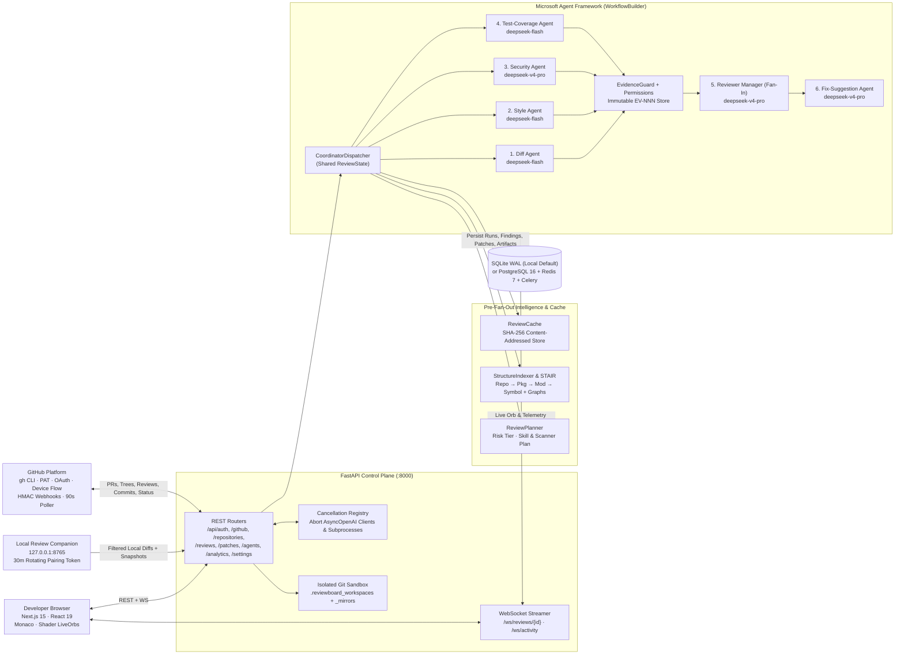
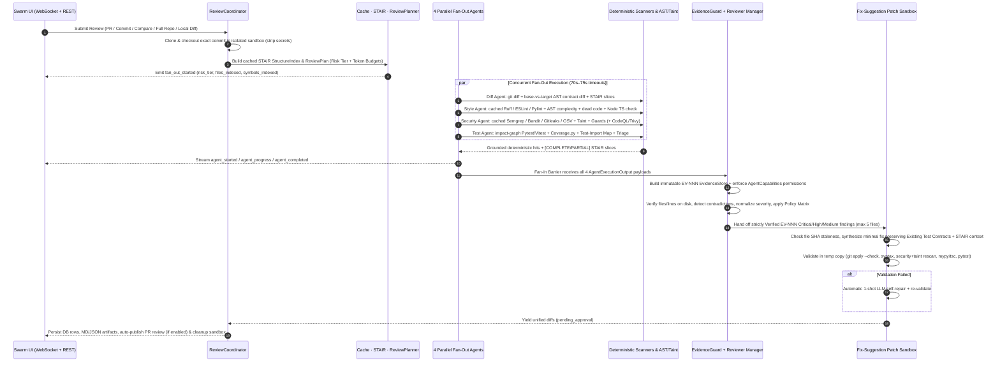

<p align="center">
  
</p>

<h1 align="center">Swarm</h1>

<p align="center">
  <strong>Multi-Agent Automated Code Review Workbench</strong><br />
  6-Agent Microsoft Agent Framework Orchestration · STAIR Code Intelligence · Independent <code>EvidenceGuard</code> · Sandbox-Verified Patch Synthesis
</p>

<p align="center">
  
  
  
  
  
  
</p>

<p align="center">
  <a href="#core-capabilities--safeguards">Capabilities</a> ·
  <a href="#system-architecture">System Architecture</a> ·
  <a href="#how-the-6-agent-swarm-works">How the 6-Agent Swarm Works</a> ·
  <a href="#pre-fan-out-intelligence-planning--caching">Intelligence &amp; Cache</a> ·
  <a href="#agent-capabilities-engines--permissions">Skills &amp; Permissions</a> ·
  <a href="#evidenceguard--decision-policy-matrix">EvidenceGuard &amp; Policy</a> ·
  <a href="#web-workbench-routes">Web Workbench</a> ·
  <a href="#quick-start-local--zero-docker">Quick Start</a> ·
  <a href="#project-structure">Project Structure</a>
</p>

---

**Swarm** is a full-stack multi-agent code review workbench built with **Next.js 15**, **FastAPI**, and **Microsoft Agent Framework** (`WorkflowBuilder`). Every submitted PR, commit, branch comparison, full repository audit, or local diff executes inside an isolated Git sandbox where Swarm builds a **STAIR hierarchical code & dependency index**, classifies change risk in a central **ReviewPlanner**, runs deterministic static/security/taint/test engines, dispatches **four parallel Fan-Out agents**, verifies every finding against an LLM-independent **`EvidenceGuard` + Reviewer Manager (Fan-In)** barrier, and validates generated patches inside a separate temporary copy—requiring explicit human approval before any change touches disk or GitHub.

> **Zero Fake Data & Independent Verification Contract**
> Every repository tree, commit SHA, PR diff, scanner hit, coverage percentage, latency metric, and patch proposal comes directly from real Git objects, real static/security/test runners, and live OpenAI-compatible (DeepSeek) API calls. **No LLM can ever self-certify a finding as `Verified`.**

---

## Core Capabilities & Safeguards

| Problem Addressed | Implemented Engineering Mechanism |
|---|---|
| **Truncated-diff hallucinations** (*"missing check"* when validation exists deeper in file) | [`structure_indexer.py`](backend/app/intelligence/structure_indexer.py) + [`stair_retriever.py`](backend/app/intelligence/stair_retriever.py) index `Repository → Package → Module → Symbol` (up to `180` files, `250` symbols/module) with `implemented_guards` across the full file, 1-hop caller/callee/import/test edges, and `[COMPLETE FILE]` / `[PARTIAL FILE]` context headers. |
| **LLM-forged scanner citations & self-certified badges** | [`evidence_guard.py`](backend/app/verification/evidence_guard.py) builds an immutable `EV-001`, `EV-002`, … `EvidenceStore` from deterministic scanner runs, validates disk files & lines (`±3` line tolerance), and downgrades unbacked `Verified` tags or fabricated tool attributions. |
| **Agents claiming tests ran when only reading code** | [`permissions.py`](backend/app/skills/permissions.py) (`AgentCapabilities`) enforces permitted engines and strips any test/mutation execution claim (`"ran tests"`, `"tests passed"`, `"mutation tested"`) unless matching `pytest`/`vitest` execution telemetry confirms `status == "completed"`. |
| **False *"untested module"* findings on helpers** | [`test_tools.py`](backend/app/scanners/test_tools.py) constructs a Cross-File Test-Import Coverage Map (`direct_tests`, `indirect_importing_tests`, `mocked_only_in_tests`, `test_suites` + `skipIf` extraction) across Python and TS/JS imports. |
| **Test fixtures triggering secret-leak alerts** | [`code_engines.py`](backend/app/scanners/code_engines.py) (`is_test_fixture_hit`) detects synthetic test-fixture strings inside test files and normalizes Gitleaks hits on fixtures to `Low` informational. |
| **Docs-only diffs marked `Incomplete` & wasted tokens** | [`review_planner.py`](backend/app/planning/review_planner.py) marks docs/static-asset diffs `low` risk (`skipped_by_plan`), while Style, Security, Diff, and Test agents apply deterministic **Token-Saver** short-circuits and [`ReviewCache`](backend/app/cache/review_cache.py). |
| **Unsafe or non-compiling AI patches** | [`fix_suggestion_agent.py`](backend/app/agents/fix_suggestion_agent.py) strictly gates patch generation on `Verified` `EV-NNN` findings, checks source hash staleness, injects `Existing Test Contracts`, and validates inside an isolated temporary workspace (`git apply --check`, Python/Node syntax check, security + taint rescan, optional `mypy`/`tsc`, and targeted `pytest`)—with automatic **1-shot self-repair**. |
| **Canceling slow runs still drains API quota** | [`cancellation.py`](backend/app/orchestration/cancellation.py) closes active `AsyncOpenAI` clients tracked per review ID, cancels the workflow task, kills running child subprocesses, marks unfinished orbs neutrally as stopped, and enables one-click **Re-run** or **Leave Task**. |

---

## System Architecture



### Five-Layer Design

1. **Presentation Layer (`frontend/`)**: Next.js `15.3+` (App Router), React `19.1`, TypeScript `5.8`, Tailwind CSS `v4`, Monaco `Editor` & `DiffEditor`, auto-reconnecting WebSockets (`connectResilientWebSocket`), and lightweight custom components ([`LiquidNavbar`](frontend/src/components/ui/liquid-navbar.tsx), raw GLSL `<canvas>` / CSS [`LiveOrb`](frontend/src/components/ui/live-orb.tsx), [`GlassFolder`](frontend/src/components/ui/glass-folder-cards.tsx)—with zero Three.js dependencies).
2. **Control Plane (`backend/app/api/`, `backend/app/services/`)**: FastAPI REST routers, dual WebSocket channels (`/ws/reviews/{id}`, `/ws/activity`), Fernet encryption, PBKDF2-HMAC-SHA256 + HS256 JWT auth (plus local workspace auto-provisioning), isolated Git sandbox manager, `90s` GitHub background PR poller, and active HTTP/subprocess cancellation.
3. **Intelligence, Planning & Caching (`backend/app/intelligence/`, `backend/app/planning/`, `backend/app/cache/`)**: Incremental content-addressed `ReviewCache`, STAIR 4-level symbol/import/call/test-link indexer, token-budgeted context retriever, and deterministic `ReviewPlanner`.
4. **Orchestration, Permissions, Verification & Scanners (`backend/app/orchestration/`, `backend/app/agents/`, `backend/app/skills/`, `backend/app/verification/`, `backend/app/scanners/`)**: Microsoft Agent Framework `WorkflowBuilder` Fan-Out / Fan-In graph, shared contracts, `AgentCapabilities` runtime boundaries, `EvidenceGuard`, and deterministic static, taint, AST, syntax, and test engines.
5. **Persistence Layer (`backend/app/models/tables.py`, `backend/app/database/session.py`)**: 11 async SQLAlchemy ORM tables with automatic SQLite WAL setup and idempotent SQLite column migration in `init_db()`.

---

## How the 6-Agent Swarm Works

When a review starts, [`ReviewCoordinator.execute_review`](backend/app/orchestration/coordinator.py) checks out `target_commit` (and overlays local working-tree/companion snapshots when applicable) inside `<WORKSPACE_DIR>/<review_id>`, strips sensitive credential files, runs pre-Fan-Out indexing/planning, executes the `WorkflowBuilder` graph within a `240s` timeout, persists results, optionally publishes to GitHub PRs, and removes the ephemeral sandbox in a `finally:` block.



### Agent Roles, Default Models & Budgets

Every agent uses `OpenAIChatCompletionClient` (via Microsoft Agent Framework `as_agent`) with strict JSON output parsing, single-retry JSON extraction fallback, and independent **Model**, **Base URL**, **Fernet-encrypted API Key**, and **Temperature** settings configured in `.env` or `/settings`.

| # | Agent | Stage | Default Model | Timeout | Token Budget | Deterministic Context & Checks Run |
|---|---|---|---|---|---|---|
| 1 | **Diff Agent** | Fan-Out (Parallel) | `deepseek-flash` | `70s` | `3,000` (`1,200` light) | `git diff --stat`, unified hunk line parser, base-vs-target AST diff ([`diff_engines.py`](backend/app/scanners/diff_engines.py): `_VarNormalizer` cosmetic rename vs algorithm/permission edits, API contract drift, `os.getenv`/`process.env`/manifest config impact, downstream importer/caller counts), polyglot guard facts |
| 2 | **Style Agent** | Fan-Out (Parallel) | `deepseek-flash` | `70s` | `2,000` | Cached `ruff`, optional repo-local/global `eslint` & `pylint`, Python AST complexity (`>60`-line functions, nesting `≥4`, branches `≥8`, imports `≥15`), 120-char lines, repo snake/camel naming convention & existing helper check, `≥6`-line SHA-256 duplicate block detector, dead-code analyzer (`DEAD-UNREACHABLE-CODE`, `DEAD-UNUSED-PRIVATE-SYMBOL`), JS `console.log`/repeated dynamic-import checks, Node VM syntax check; skips LLM call completely when `cfg.api_key` is set and deterministic lints are clean/unambiguous (`≤15` hits) or `skip_scanners=True` |
| 3 | **Security Agent** | Fan-Out (Parallel) | `deepseek-v4-pro` | `75s` | `5,000` (`6,500` High Risk) | Cached `semgrep` (`10` local rules in [`semgrep_rules.yml`](backend/app/scanners/semgrep_rules.yml)), `bandit`, `gitleaks` (test-fixture tagging), `osv-scanner`, `security-guard` (Basic/Digest redaction bypass, SSRF missing private-IP filter, JS shell template injection, syntax validity), deterministic `security-taint` analyzer ([`security_taint.py`](backend/app/scanners/security_taint.py): Python AST + TS/JS source-to-sink SQLi/CMDi/path traversal/eval/pickle/DOM XSS, mutating route authz checks, weak MD5/SHA1 & `random` token generation, caller exposure), optional `codeql` & `trivy`; skips deep LLM pass when `skip_scanners=True` or low-risk with `0` hits & `0` threat surfaces |
| 4 | **Test-Coverage Agent** | Fan-Out (Parallel) | `deepseek-flash` | `70s` | `3,500` | Cross-file `test_import_map` (direct + indirect imports vs `vi.mock`/`jest.mock`-only, test function extraction, `skipIf` capture), impact-graph selective `pytest` (`selection_mode="impact_graph_subset"` or `full_suite`) + `coverage.py` line coverage or Vitest / `static_js_ts_inspection`, deterministic [`triage_test_failure`](backend/app/scanners/test_tools.py#L252) (`code_assertion_failure`, `dependency_or_env_failure`, `syntax_or_collection_error`, `timeout`), pure-function `Hypothesis` / `fast-check` invariant candidate & optional `mutmut`/`stryker` availability detector |
| 5 | **Reviewer Manager** | Fan-In Barrier | `deepseek-v4-pro` | `95s` | `3,000` (`3,900` High Risk) | Consolidates all 4 outputs, builds immutable `EV-NNN` `EvidenceStore`, enforces `AgentCapabilities` permissions, verifies disk paths & line numbers (`±3` lines), detects cross-agent & guard/test-map contradictions, applies primary tool rank (`_PRIMARY_TOOL_RANK`) & normalized severity criteria, deduplicates items, evaluates **Decision Policy Matrix** (runs deterministically even on missing LLM key or error) |
| 6 | **Fix-Suggestion Agent** | Patch Sandbox | `deepseek-v4-pro` | `85s` (+ `70s` repair) | `4,000` | Minimal patches strictly for `Verified` `EV-NNN` findings (`≤5` source files, non-fixture), `_check_patch_conflict` file SHA guard, injects `Existing Test Contracts` + STAIR caller context, accepts optional `regression_test_code`, validates in isolated temp copy (`git apply --check`, syntax check, security + taint regression rescan, optional `mypy`/`tsc`, targeted `pytest`), automatic **1-shot self-repair**, awaits human approval |

---

## Pre-Fan-Out Intelligence, Planning & Caching

[`CoordinatorDispatcher.dispatch`](backend/app/orchestration/fanout_fanin.py) runs three deterministic modules before fanning out to the four parallel specialists:

### 1. STAIR Hierarchical Indexing & Context Retrieval (`backend/app/intelligence/`)
- **[`build_structure_index`](backend/app/intelligence/structure_indexer.py#L436)**: Indexes up to `180` prioritized non-ignored files (`≤ 250,000` bytes each), parsing Python with `ast` and TS/JS with declaration + brace-block span tracking (`up to 250 symbols/module`, plus optional `tree_sitter` detection via `importlib.util.find_spec`). Builds:
  - 4-level ToC: `Repository → Package → Module → Symbol` (with exact 1-based line ranges & signatures)
  - Full-file defensive guard locations (`implemented_guards`)
  - Five dependency graphs: `imports`, `imported_by`, `calls`, `called_by`, and `test_links`
- **[`retrieve_relevant_context`](backend/app/intelligence/stair_retriever.py#L118)**: Scores modules and symbols by diff-hunk overlap (`+100`), scanner/evidence hit overlap (`+110`), defensive guards (`+55` for Security/Manager), role keywords, and 1-hop caller/callee/import/test edges—preventing line-1 truncation blindness on large (`400+` line) files.
- **[`build_agent_context`](backend/app/intelligence/context_builder.py#L34)**: Packs ToC + top slices within strict per-agent token budgets (expanding by `+30%` on `high` risk), falling back cleanly to `read_prioritized_workspace_files` when a repository has no indexed AST/text symbols.

### 2. Central Review Planner (`backend/app/planning/review_planner.py`)
- **Risk Scoring**: Evaluates auth/security/API/DB paths (`+3`), risky diff constructs (`eval`, `exec`, `shell=True`, `dangerouslySetInnerHTML`, `SELECT ... FROM`, `jwt`, `oauth`, `secret`, `password`, `chmod`, `CORS`, `+3`), dependency manifests (`+2`), downstream fan-in (`≥ 4` importers, `+2`), and large diff churn (`≥ 350` lines or `≥ 10` files, `+1`) to classify diffs as **`high`** (`score ≥ 3`), **`medium`** (`score ≥ 1`), or **`low`** / **`docs_only`**.
- **Clean Selective Execution**: Documentation/asset-only diffs skip heavy code scanners with `status="skipped_by_plan"` (never causing false `Incomplete` results), enables `codeql` on `high` risk and `trivy` on `high` risk or dependency edits, and toggles selective impacted-test execution.

### 3. Content-Addressed Incremental Cache (`backend/app/cache/review_cache.py`)
`structure_index`, `security_scanners`, and `style_scanners` cache results under `<WORKSPACE_DIR>/_cache/<namespace>/` (up to `250` JSON entries per namespace with atomic writes and mtime LRU pruning):

```text
cache_key = sha256(content_hash + "|" + tool_version + "|" + configuration_hash + "|" + commit_context)
```

Transient `error` / `incomplete` scanner states are never cached. Any file content change, Semgrep rules edit, scanner binary `--version` change, planner/policy config change, or commit range update automatically misses and recomputes.

---

## Agent Capabilities, Engines & Permissions

[`AGENT_CAPABILITY_REGISTRY`](backend/app/skills/permissions.py#L36-L185) explicitly decouples **Skills** (what an agent analyzes), **Engines** (what deterministic tools it runs), and **Permissions** (what it may claim or mutate):

| Agent Key | Permitted Deterministic / Reasoning Engines | Optional Host/Repo Engines | Propose Patches | Commit Directly | Verify Test Execution | Self-Certify `Verified` |
|---|---|---|---|---|---|---|
| `diff_agent` | `git-diff`, `diff-ast-engine`, `llm-review` | `tree_sitter` | `False` | `False` | `False` | `False` |
| `style_agent` | `ruff`, `ast-complexity`, `ast-style-checker`, `js-style-checker`, `duplicate-detector`, `dead-code-analyzer`, `python-ast`, `ts-syntax-checker`, `llm-style-review`, `llm-review` | `eslint`, `pylint` | `False` | `False` | `False` | `False` |
| `security_agent` | `semgrep`, `bandit`, `gitleaks`, `osv-scanner`, `security-guard`, `security-taint`, `llm-security-review`, `llm-review` | `codeql`, `trivy` | `False` | `False` | `False` | `False` |
| `test_coverage_agent` | `pytest`, `vitest`, `coverage.py`, `test-mapper`, `llm-test-review`, `llm-review` | `hypothesis`, `mutmut` | `False` | `False` | `True` *(only when runner executed)* | `False` |
| `reviewer_manager` | `evidence-guard` + all deterministic engines above + `llm-review` | — | `False` | `False` | `False` | `False` |
| `fix_suggestion_agent` | `git-apply-check`, `python-ast`, `ts-syntax-checker`, `security-guard`, `security-taint`, `pytest`, `vitest` | `mypy`, `tsc` | **`True`** *(Verified `EV-NNN` only)* | `False` *(Human gated)* | `True` *(isolated temp sandbox)* | `False` |

> When optional host/repo tools (`eslint`, `pylint`, `codeql`, `trivy`, `mypy`, `tsc`, `hypothesis`, `mutmut`, `tree_sitter`, `vitest`) are not installed locally, Swarm reports `optional_unavailable` (or `executed: False` for property/mutation runs) transparently without failing Priority 1 checks or fabricating execution results.

---

## EvidenceGuard & Decision Policy Matrix

- **Immutable Provenance Store ([`evidence_guard.py`](backend/app/verification/evidence_guard.py))**: Deterministic outputs create sequential `EvidenceRecord` entries (`EV-001`, `EV-002`, …) containing `tool_name`, `rule_id`, `file_path`, `line_number`, `end_line`, `commit_sha`, `source_hash` (16-char SHA-256 prefix), `snippet`, and `severity`.
- **LLM Independence**: All Fan-Out agents emit `verification_status="Needs Verification"` alongside numeric `confidence` (`0.0–1.0`). Only [`verify_finding_provenance`](backend/app/verification/evidence_guard.py#L318) promotes `"Verified"` upon exact `(file_path, tool/rule, line ±3)` or `EV-NNN` match; missing files become `"Unverified"`, and unbacked deterministic tool claims count toward `fabricated_tool_claims_count`.
- **Contradiction & Severity Normalization**: [`check_finding_contradiction`](backend/app/verification/evidence_guard.py) and [`detect_cross_agent_contradictions`](backend/app/verification/evidence_guard.py) filter harness noise and false *"missing guard / missing test"* claims contradicted by `implemented_guards_in_full_file` or `test_import_map`; [`normalize_severity_with_criteria`](backend/app/verification/evidence_guard.py) enforces uniform severity rules (`Critical` for tainted SQLi/CMDi, `High` for syntax breakage/path traversal/insecure PRNG, `Low` for test fixtures and unused private helpers).

### Deterministic Decision Policy Matrix

Evaluated inside [`_evaluate_review_policy`](backend/app/agents/reviewer_manager.py) after Fan-In and re-evaluated after Fix-Suggestion:

| Priority | Condition | Final Recommendation |
|---|---|---|
| **1** | User clicked **Stop Operation** OR `require_all_mandatory_scans` is enabled and any mandatory agent/scanner timed out, failed, or lacked an API key | **`Incomplete`** |
| **2** | `require_tests_pass` is enabled and executed test suite reported `failed > 0` | **`Request Changes`** |
| **3** | At least one **`Verified`** finding is `Critical` (`block_on_critical=true`) or `High` (`block_on_high=true`) | **`Request Changes`** |
| **4** | All mandatory checks completed cleanly with zero verified blockers | **`Approve`** |

---

## Security & Hardening

- **Isolated Git Sandbox ([`git_workspace.py`](backend/app/services/git_workspace.py))**: Clones into `<WORKSPACE_DIR>/<review_id>`, checks out exact commits, strips `.env`, `.env.*`, `*.pem`, `*.key`, `*.p12`, `*.pfx`, `id_rsa*`, `id_ed25519*`, `credentials.json`, and custom `excluded_paths`, validates refs with `validate_git_ref` (blocking `-` flags, whitespace, `..`, `@{`, `\`), confines reads via `resolve_within_dir`, ignores symlinks, and removes sandboxes in `finally:`.
- **Secret Encryption & Subprocess Isolation ([`crypto.py`](backend/app/services/crypto.py), [`tool_runner.py`](backend/app/scanners/tool_runner.py))**:
  - Passwords hashed with **PBKDF2-HMAC-SHA256** (`260,000` iterations); JWTs signed with HS256.
  - LLM API keys and GitHub OAuth/PAT tokens stored Fernet-encrypted (`ENCRYPTION_KEY`, or SHA-256 derived from `SECRET_KEY`).
  - Remote Git auth passes credentials via ephemeral `0o500` `GIT_ASKPASS` helpers (closed before execution and unlinked in `finally:`), never embedding secrets in `.git/config`.
  - Scanner/test processes execute under `sanitized_subprocess_env()`, stripping `SECRET_KEY`, `DEEPSEEK_API_KEY`, `GITHUB_TOKEN`, and backend env secrets.
- **Local Review Companion ([`local-companion/`](local-companion/))**: Binds strictly to `127.0.0.1:8765`, requires a 30-minute rotating `X-Pairing-Token` (`hmac.compare_digest`), blocks non-Git directories and `..` path escapes, validates outbound `backend_url` against non-loopback HTTP/SSRF targets, and excludes secrets/keys before extracting diffs.

---

## GitHub Integration, Explorer & Patch Workflow

- **Four Connection Paths ([`github.py`](backend/app/api/github.py), [`github_client.py`](backend/app/integrations/github_client.py))**:
  1. **GitHub CLI (`gh`)** (`POST /api/github/connect/gh-cli`)
  2. **Personal Access Token (PAT)** (`POST /api/github/connect/pat`)
  3. **GitHub OAuth Web Flow** (`GET /api/github/oauth/url` + `POST /api/github/oauth/exchange`)
  4. **GitHub OAuth Device Flow** (`POST /api/github/device-flow/start` + `/poll`)
- **Flexible Import & Auto-Discovery**: `parse_github_repo_input` parses `owner/repo`, HTTPS repo URLs, SSH remotes, `/pull/<number>`, and `/commit/<sha>` links (with `git ls-remote --symref` fallback when REST rate limits hit). Supports both HMAC-verified webhooks (`POST /api/github/webhook` via `X-Hub-Signature-256`) and automatic **90-second background PR polling** (`github_background_poller` in `app/main.py`) with per-repo `auto_review_webhooks` toggles.
- **Rate-Limit-Resilient Codebase Explorer**: Browses trees/files across GitHub branches via REST with automatic shallow mirror fallback (`<WORKSPACE_DIR>/_mirrors/`) and 1-click **Full Codebase Audit**.
- **PR Publishing & Gated Patch Commits ([`patches.py`](backend/app/api/patches.py))**:
  - Publish full Markdown summaries, `APPROVE` / `REQUEST_CHANGES` / `COMMENT` PR reviews, inline line comments, and Commit Status checks (`POST /api/github/reviews/{review_id}/publish`).
  - Inside `/patches` and `/reviews/[id]`, inspect Monaco `DiffEditor` output alongside sandbox validation diagnostics, then trigger `Reject`, `Approve`, `Approve & Apply Locally` (`apply_local`), `Publish PR Suggestion` (`publish_github_suggestion` via `_extract_suggestion_hunk`), `Approve & Commit to GitHub` (`commit_to_github_branch`), or batch **Approve & Commit All to GitHub** (`POST /api/patches/commit-all-github`) with SHA-conflict detection (`409 Conflict` / skipped stale items).

---

## Web Workbench Routes

All 11 App Router pages under [`frontend/src/app/`](frontend/src/app/) communicate directly with the FastAPI backend and live WebSockets inside [`AppShell`](frontend/src/components/AppShell.tsx):

| Route | View | Key Features |
|---|---|---|
| `/` | **Dashboard** | KPI cards (`Repositories`, `Reviews`, `Findings`, `API Keys`), setup readiness checklist, recent verdicts, and 6-agent readiness |
| `/repositories` | **Repositories** | Connect GitHub (`gh` CLI, PAT, OAuth, Device Flow, PR/Commit/Repo links) or local Git directories; interactive **Glass Folder** & table views; PR sync & webhook toggle |
| `/repositories/[id]` | **Codebase Explorer** | Branch / working-tree file explorer (with shallow mirror fallback), Monaco `Editor`, and **Full Codebase Audit** trigger |
| `/reviews/submit` | **Submit Review** | Launch GitHub PR, Commit, Branch Compare, Full Codebase Audit, or Local Diff reviews (`working_tree`, `staged`, `unstaged`, `commits`) with diff preview & **Stop Operation** |
| `/agents` | **Agent Activity** | Real-time 6-orb Fan-Out / Fan-In visualization (`AgentPipelineGraph` + `LiveOrb`), live WebSocket event stream, **Stop Operation**, **Re-run**, and **Leave Task** |
| `/reviews/[id]` | **Code Review** | 3-tab detail view: **Code Review** (Monaco code/diff inspector, `Verified` / `Needs Verification` / `EV-NNN` badges, `% conf`, and filtered false positives), **Agent Execution & Tools**, **Fix Suggestions** (`DiffEditor`), MD/JSON export, & GitHub publish |
| `/patches` | **Fix Suggestions** | Cross-review patch queue with Monaco `DiffEditor`, validation diagnostics, **Approve & Commit All to GitHub**, plus per-patch approval/apply/commit actions |
| `/history` | **Review History** | Filterable ledger across repositories, trigger types, recommendations, and GitHub publication status |
| `/analytics` | **Analytics** | Real SQL aggregations by severity, verification status, tool/agent, top affected files, decision timeline, and agent latency (`ms`) |
| `/architecture` | **Project Guide** | Interactive 6-orb breakdown documenting inputs, STAIR token budgets, safeguards, and Policy Matrix priority order |
| `/settings` | **Settings** | Per-agent model/URL/API key/temperature configuration, bulk key setter, live **Test Connection**, Review Policy toggles & excluded paths, and installed scanner status |

---

## Quick Start (Local · Zero Docker)

### Prerequisites
- **Python 3.12+** with `venv`
- **Node.js 18+** and `npm`
- **Git** CLI
- **Optional external security/lint binaries** (auto-detected on `PATH`, `backend/.venv/bin`, or repo `node_modules/.bin`):
  - Core CLI checks (`/api/settings/scanners`): `git`, `semgrep`, `gitleaks`, `bandit`, `osv-scanner`, `ruff`, `pytest`, `coverage`, `node` (`bandit`, `ruff`, `pytest`, `coverage` install via `backend/requirements.txt`; macOS Homebrew example for remaining core tools: `brew install semgrep gitleaks osv-scanner`)
  - Optional extra tools: `eslint`, `pylint`, `codeql`, `trivy`, `mypy`, `tsc`, `hypothesis`, `mutmut`

### 1. Clone & Configure Environment

```bash
git clone https://github.com/kollisathwikkumar/Swarm.git
cd Swarm
cp .env.example .env
```

Set `SECRET_KEY` and add your DeepSeek key(s) in `.env` (`DEEPSEEK_API_KEY` or per-agent `*_API_KEY`), or configure and test keys live in **`/settings`** once running.

### 2. Install Backend & Frontend Dependencies

```bash
python3.12 -m venv backend/.venv
backend/.venv/bin/pip install -r backend/requirements.txt

npm --prefix frontend install
```

### 3. Launch Swarm

```bash
chmod +x start-local.sh
./start-local.sh
```

[`start-local.sh`](start-local.sh) copies `.env.example` if missing, clears stale `frontend/.next` cache, starts FastAPI with `--reload` on **`http://127.0.0.1:8000`** (OpenAPI docs at `/docs`), and starts Next.js on **`http://localhost:3000`**.

---

## Optional: Local Review Companion CLI

Use [`local-companion/`](local-companion/) to inspect local Git repositories or submit local diffs cleanly from the CLI:

```bash
backend/.venv/bin/pip install -r local-companion/requirements.txt

# 1. Start the loopback companion service on 127.0.0.1:8765 (prints a 30-min Pairing Token)
backend/.venv/bin/python local-companion/cli.py serve --port 8765

# 2. Inspect a local repository summary JSON
backend/.venv/bin/python local-companion/cli.py inspect /path/to/repo

# 3. Extract and submit staged/unstaged/working_tree/commit diffs to Swarm
backend/.venv/bin/python local-companion/cli.py submit /path/to/repo --mode working_tree --backend http://127.0.0.1:8000
```

---

## Optional: Production Docker Stack (PostgreSQL + Redis + Celery)

[`docker-compose.yml`](docker-compose.yml) runs `postgres:16-alpine`, `redis:7-alpine`, `backend` (`uvicorn`), `celery-worker` (`celery -A app.services.tasks.celery_app worker`), and `frontend` (`next start`):

```bash
cp .env.example .env
# Populate SECRET_KEY and DEEPSEEK_API_KEY in .env
docker compose up --build
```

- **Frontend**: `http://localhost:3000`
- **Backend API**: `http://localhost:8000`

---

## Configuration, Database & API Reference

<details>
<summary><strong>Environment Variables (<code>.env.example</code>)</strong></summary>

| Variable | Default | Description |
|---|---|---|
| `APP_ENV` | `development` | Application environment |
| `SECRET_KEY` | `change-this-to-a-random-64-char-secret` | HS256 JWT signing key + fallback Fernet key derivation |
| `ENCRYPTION_KEY` | `""` | Optional dedicated Fernet encryption key for stored API keys & GitHub tokens |
| `ALLOWED_ORIGINS` | `http://localhost:3000,http://127.0.0.1:3000` | Comma-separated CORS origins |
| `WORKSPACE_DIR` | `./.reviewboard_workspaces` | Ephemeral sandboxes, `_cache/`, and `_mirrors/` root |
| `DATABASE_URL` | `sqlite+aiosqlite:///./reviewboard.db` | Async SQLAlchemy URL (SQLite WAL or `postgresql+asyncpg://...`) |
| `CELERY_ENABLED` | `false` | Dispatch review execution to Celery + Redis when `true` |
| `REDIS_URL` | `redis://localhost:6379/0` | Celery broker & backend URL |
| `DEEPSEEK_BASE_URL` | `https://api.deepseek.com` | Global OpenAI-compatible LLM base URL |
| `DEEPSEEK_API_KEY` | `""` | Shared fallback API key across all 6 agents |
| `<AGENT>_MODEL` / `_BASE_URL` / `_API_KEY` | `deepseek-flash` / `deepseek-v4-pro` | Per-agent overrides for `DIFF_AGENT`, `STYLE_AGENT`, `SECURITY_AGENT`, `TEST_COVERAGE_AGENT`, `REVIEWER_MANAGER`, `FIX_SUGGESTION_AGENT` |
| `GITHUB_TOKEN` | `""` | Optional default GitHub PAT (overridden by UI-connected accounts) |
| `GITHUB_CLIENT_ID` / `GITHUB_CLIENT_SECRET` | `""` | Required only for GitHub OAuth Web Flow / Device Flow |
| `GITHUB_OAUTH_REDIRECT_URI` | `http://localhost:3000/settings?github_oauth=callback` | OAuth callback URL |
| `GITHUB_WEBHOOK_SECRET` | `""` | HMAC-SHA256 secret for verifying `X-Hub-Signature-256` on `/api/github/webhook` |
| `LOCAL_COMPANION_URL` | `http://127.0.0.1:8765` | Local Companion health probe URL |

</details>

<details>
<summary><strong>Database Schema (11 Async SQLAlchemy Tables in <code>backend/app/models/tables.py</code>)</strong></summary>

| Table | Purpose |
|---|---|
| `users` | Workspace accounts (auto-provisions `workspace@reviewboard.local` locally or supports explicit registration via `/api/auth`) |
| `connected_accounts` | GitHub PAT, `gh_cli`, `oauth`, and `oauth_device` credentials encrypted with Fernet |
| `repositories` | Registered GitHub or local Git repositories, branch metadata, and `auto_review_webhooks` preference |
| `code_changes` | Captured PR, commit, branch-compare, full-repo, or local diff payloads, changed files, and `file_snapshots` |
| `reviews` | Review status (`queued`, `running`, `completed`, `stopped`, `failed`), recommendation, diff summary, `shared_state_json` snapshot, and GitHub review link |
| `agent_runs` | Per-agent run state, model used, duration (`ms`), summary, `tool_results`, `raw_output`, and error messages |
| `findings` | Consolidated findings with `verification_status`, `evidence_ids` (`EV-NNN`), `confidence`, `deduplicated_sources`, `priority_rank`, and `is_blocking` |
| `review_artifacts` | Persisted `consolidated_report_md` and `consolidated_report_json` exports |
| `patch_suggestions` | Unified diffs, `original_code`, `proposed_code`, `applicability_verified`, `validation_output`, and `approval_status` (`pending_approval` / `approved` / `rejected` / `applied`) |
| `review_policies` | Default blocking & execution rules (`block_on_critical`, `block_on_high`, `require_tests_pass`, `require_all_mandatory_scans`, `enable_test_execution`, `auto_publish_github_review`, `excluded_paths`) |
| `agent_llm_configs` | Per-agent model, base URL, Fernet-encrypted API key, temperature, and connection test telemetry |

</details>

<details>
<summary><strong>REST &amp; WebSocket API Surface</strong></summary>

- **Health & Real-Time Streams**: `GET /health`, `WS /ws/reviews/{review_id}`, `WS /ws/activity`
- **Auth (`/api/auth`)**: `GET /bootstrap-status`, `POST /register`, `POST /login`, `GET /me`
- **GitHub (`/api/github`)**: `GET /accounts`, `POST /connect/pat`, `DELETE /accounts/{account_id}`, `GET /oauth/url`, `POST /oauth/exchange`, `GET /remote-repos`, `GET /gh-cli/status`, `POST /connect/gh-cli`, `POST /device-flow/start`, `POST /device-flow/poll`, `POST /sync-repo`, `GET /repos/{repo_id}/branches`, `GET /repos/{repo_id}/commits`, `GET /repos/{repo_id}/pulls`, `GET /repos/{repo_id}/pulls/{pr_number}/diff`, `GET /repos/{repo_id}/compare`, `GET /repos/{repo_id}/commits/{sha}/diff`, `POST /repos/{repo_id}/sync-prs`, `POST /repos/{repo_id}/register-webhook`, `POST /reviews/{review_id}/publish`, `POST /webhook`
- **Repositories (`/api/repositories`)**: `GET ""`, `POST /local`, `PATCH /{repo_id}`, `DELETE /{repo_id}`, `GET /{repo_id}/local-inspect`, `GET /companion/status`, `POST /companion/submit`, `GET /{repo_id}/tree`, `GET /{repo_id}/file`
- **Reviews (`/api/reviews`)**: `POST ""`, `GET ""`, `GET /{review_id}`, `POST /{review_id}/rerun`, `POST /{review_id}/stop`, `DELETE /{review_id}`, `GET /{review_id}/report?format=markdown|json`
- **Patches (`/api/patches`)**: `GET ""`, `POST /commit-all-github`, `POST /{patch_id}/decision` (`approve`, `reject`, `apply_local`, `publish_github_suggestion`, `commit_to_github_branch`)
- **Agents & Analytics (`/api/agents`, `/api/analytics`)**: `GET /api/agents/overview`, `GET /api/agents/runs`, `GET /api/analytics/summary`
- **Settings (`/api/settings`)**: `GET /llm-agents`, `PUT /llm-agents/{agent_name}`, `POST /llm-agents/bulk-key`, `POST /llm-agents/{agent_name}/test`, `GET /policy`, `PUT /policy`, `GET /scanners`

</details>

---

## Project Structure

```text
Swarm/
├── start-local.sh                         # One-command local dev launcher (FastAPI :8000 + Next.js :3000)
├── docker-compose.yml                     # PostgreSQL 16 + Redis 7 + FastAPI + Celery Worker + Next.js
├── .env.example                           # Environment, DeepSeek models & GitHub config template
├── docker/
│   ├── Dockerfile.backend                 # Python 3.12-slim backend container
│   └── Dockerfile.frontend                # Node 22-alpine multi-stage Next.js container
├── docs/
│   ├── ARCHITECTURE.md                    # 5-layer architecture, intelligence & policy reference
│   └── PROJECT_EXPLANATION.md             # Engineering walkthrough & safeguards summary
├── backend/
│   ├── pyproject.toml                     # Python >=3.12 metadata & Ruff lint rules
│   ├── requirements.txt                   # FastAPI, Agent Framework, SQLAlchemy, Bandit, Ruff, Pytest, Coverage
│   ├── app/
│   │   ├── main.py                        # FastAPI entrypoint, CORS, WebSockets, lifespan & 90s poller
│   │   ├── config.py                      # Settings & AGENT_METADATA (6 agents)
│   │   ├── database/session.py            # Async engine, SQLite WAL pragmas & idempotent schema init
│   │   ├── models/tables.py               # 11 SQLAlchemy ORM tables
│   │   ├── api/                           # auth, github, repositories, reviews, patches, agents, analytics, settings, deps
│   │   ├── cache/review_cache.py          # Content-addressed SHA-256 incremental disk cache
│   │   ├── intelligence/                  # STAIR structure_indexer, stair_retriever, context_builder
│   │   ├── planning/review_planner.py     # Risk classification, selective scanner & token-budget planner
│   │   ├── skills/                        # permissions (AgentCapabilities) & shared_contracts
│   │   ├── verification/evidence_guard.py # Immutable EV-NNN EvidenceStore, provenance & contradiction guard
│   │   ├── orchestration/                 # coordinator, fanout_fanin (WorkflowBuilder), shared_state, cancellation
│   │   ├── agents/                        # diff, style, security, test_coverage, reviewer_manager, fix_suggestion, llm_factory
│   │   ├── scanners/                      # code_engines, diff_engines, security_taint, security_tools, style_tools, test_tools, git_diff_tool, tool_runner, semgrep_rules.yml
│   │   ├── integrations/github_client.py  # Async GitHub REST, OAuth, Device Flow, PR comments & webhooks
│   │   └── services/                      # crypto, git_workspace, github_sync, tasks (Celery), websocket_manager
│   └── tests/
│       └── test_reviewboard.py            # 24 unit, scanner, STAIR, EvidenceGuard, P0-P4, E2E & security tests
├── frontend/
│   ├── next.config.ts                     # React strict mode & output tracing config
│   ├── package.json                       # Next.js 15.3+, React 19.1, TypeScript 5.8, Monaco, Tailwind CSS v4, Lucide
│   └── src/
│       ├── app/                           # 11 App Router pages (/, repositories, reviews, agents, patches, history, analytics, architecture, settings)
│       ├── components/                    # AppShell, AgentPipelineGraph, StatusBadges, ui/ (glass-folder-cards, liquid-navbar, live-orb)
│       └── lib/                           # api.ts (REST + resilient WebSocket), theme.ts, types.ts, utils.ts
└── local-companion/
    ├── requirements.txt                   # FastAPI, Uvicorn, GitPython, HTTPX, Pydantic
    ├── cli.py                             # Companion CLI (`serve`, `inspect`, `submit`)
    ├── local_service.py                   # 127.0.0.1 pairing-token FastAPI server + SSRF validator
    ├── repository_reader.py               # Sensitive file exclusion & path traversal confinement
    └── diff_extractor.py                  # Staged, unstaged, working-tree, untracked & commit-range extractor
```

---

## Verification & Quality Checks

The backend test suite in [`backend/tests/test_reviewboard.py`](backend/tests/test_reviewboard.py) covers **24 automated tests** spanning cryptography, diff parsing, live scanners, P0 `EvidenceGuard` fabrication blocking, P1 STAIR retrieval, P2 `ReviewCache` invalidation, P3 `ReviewPlanner` risk tiers, P4 capability permissions, AST/contract diffs, style dead-code/token-saver bypass, deterministic taint/authz/crypto analysis, selective impacted-test execution, isolated temp-sandbox patch validation, cancellation, batch GitHub commits, and end-to-end API flows:

```bash
# Backend test suite (24 tests)
cd backend && .venv/bin/pytest -v tests/test_reviewboard.py

# Static Python lint & Bandit security scan
backend/.venv/bin/ruff check --config backend/pyproject.toml backend/app backend/tests local-companion
backend/.venv/bin/bandit -r backend/app local-companion -ll

# Frontend TypeScript check & production build
cd frontend && npx tsc --noEmit && npm run build
```
