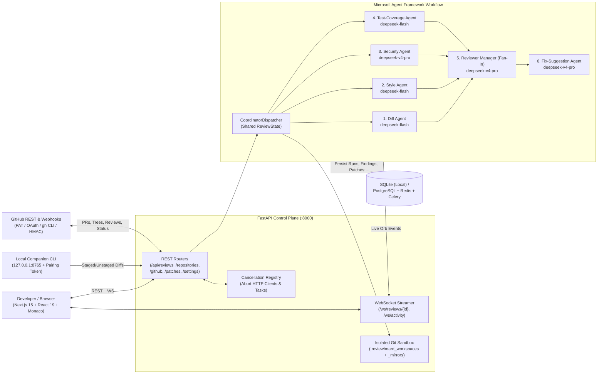
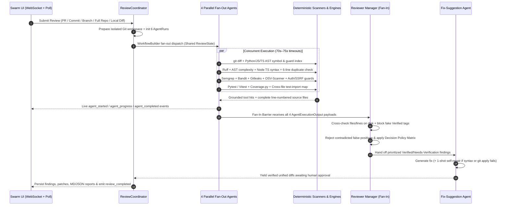

<p align="center">
  
</p>

<h1 align="center">Swarm</h1>

<p align="center">
  <strong>Multi-Agent Automated Code Review Workbench</strong><br />
  6-Agent Microsoft Agent Framework Orchestration · Deterministic Security &amp; AST Engines · Human-Gated Patch Synthesis
</p>

<p align="center">
  <a href="#system-architecture">Architecture</a> ·
  <a href="#how-the-6-agent-swarm-works">How the Swarm Works</a> ·
  <a href="#accuracy--anti-hallucination-engines">Accuracy Engines</a> ·
  <a href="#quick-start-local--zero-docker">Quick Start</a> ·
  <a href="#api--project-structure">Project Structure</a>
</p>

---

**Swarm** is an interactive multi-agent code review platform built with **Next.js 15**, **FastAPI**, and **Microsoft Agent Framework** (`WorkflowBuilder`). Instead of relying on a single monolithic LLM prompt over a truncated diff, Swarm isolates every target commit inside a dedicated Git sandbox, runs deterministic security, syntax, AST, and test-coverage engines first, dispatches **four specialist DeepSeek agents concurrently (Fan-Out)**, enforces ground-truth verification in a **Reviewer Manager (Fan-In)** barrier, and proposes `git apply --check`–verified patches that always require explicit human approval.

> **Zero Fake Data Guarantee**: Every repository tree, commit SHA, PR diff, scanner hit, coverage percentage, latency metric, and patch proposal is computed from real Git objects, real static/security/test runners, and live DeepSeek API calls.

---

## Core Capabilities

- **6-Agent Fan-Out / Fan-In Orchestration**: Parallel **Diff**, **Style**, **Security**, and **Test-Coverage** specialists converge into a central **Reviewer Manager** gate before handing prioritized verified defects to the **Fix-Suggestion Agent**.
- **Anti-Hallucination Accuracy Pipeline**: Complete line-numbered source files (`[COMPLETE FILE]` / `[PARTIAL FILE]`), polyglot SSRF/auth/lock guard indexes, cross-file test-import mapping, and strict `Verified` vs. `Needs Verification` gating prevent LLMs from inventing missing checks or bogus vulnerabilities.
- **Instant Stop, Re-run & Leave Task Controls**: Canceling a running review aborts active `AsyncOpenAI` HTTP streams, kills child scanner/Git subprocesses immediately to save tokens, and marks stopped orbs neutrally with one-click **Re-run** or **Leave Task** cleanup.
- **Full GitHub Integration + Built-In Code Explorer**: Connect GitHub via **GitHub CLI (`gh`)**, Personal Access Token (PAT), or OAuth; inspect entire repositories with **Glass Folder** browsing & Monaco syntax highlighting; trigger reviews on open PRs, commits, branch comparisons, or full codebases; receive webhooks (`X-Hub-Signature-256` verified) or background PR polling; and publish inline PR comments and commit statuses back to GitHub.
- **Local Review Companion (`local-companion/`)**: Local-only daemon (`127.0.0.1:8765`) protected by rotating 30-minute pairing tokens (`hmac.compare_digest`), path traversal blocking, and sensitive file filtering (`.env`, private keys, credentials) for reviewing uncommitted local Git diffs.
- **Human-Gated Patch Validation**: Every proposed fix is validated with both `difflib` unified diff generation + `git apply --check` and native Python (`ast.parse`) / JS & TS (`node --experimental-vm-modules`) syntax parsers, with automatic **1-shot LLM self-repair** on syntax or diff errors before human sign-off.

---

## System Architecture



---

## How the 6-Agent Swarm Works

When a review starts, [`ReviewCoordinator.execute_review`](backend/app/orchestration/coordinator.py) checks out the exact target commit (`target_commit`) plus any working-tree snapshots inside an isolated sandbox directory (automatically stripped of `.env`, private keys, and credentials, and cleaned up automatically in a `finally:` block once the run exits).



### Agent Roles & Default Model Assignments

Every agent supports independent **Model**, **Base URL**, **API Key** (Fernet-encrypted at rest in SQLite/Postgres), and **Temperature** configuration in `/settings` or `.env`:

| # | Agent | Stage | Default Model | Timeout | Deterministic Context Passed to Model |
|---|---|---|---|---|---|
| 1 | **Diff Agent** | Fan-Out (Parallel) | `deepseek-flash` | `70s` | Git diff + prioritized complete files + polyglot symbol & defensive guard index (`implemented_guards_in_full_file`) |
| 2 | **Style Agent** | Fan-Out (Parallel) | `deepseek-flash` | `70s` | `ruff` lints, Python AST cyclomatic/nesting checks, Node TS syntax parse results, dynamic-import checks, `>=6`-line duplicate block hashes |
| 3 | **Security Agent** | Fan-Out (Parallel) | `deepseek-v4-pro` | `75s` | `semgrep` (`semgrep_rules.yml`), `bandit`, `gitleaks` (with synthetic test-fixture tagging), `osv-scanner` CVEs, deterministic SSRF/auth/lock guards |
| 4 | **Test-Coverage Agent** | Fan-Out (Parallel) | `deepseek-flash` | `70s` | `pytest` + `coverage.py` or `vitest` execution telemetry, test suite discovery, and cross-file test-import coverage map |
| 5 | **Reviewer Manager** | Fan-In Barrier | `deepseek-v4-pro` | `95s` | All 4 agent outputs + disk ground-truth line verification + deterministic tool index + noise filter (`_is_harness_noise`) |
| 6 | **Fix-Suggestion Agent** | Patch Synthesis | `deepseek-v4-pro` | `85s` (+ `70s` repair) | Prioritized source findings + up to 500-line full context window + `Existing Test Contracts` assertions + `git apply --check` + AST/Node syntax checks |

---

## Accuracy & Anti-Hallucination Engines

Swarm's [`backend/app/scanners/`](backend/app/scanners/) layer exists specifically to eliminate common LLM review hallucinations:

1. **Full File Grounding & Guard Indexing ([`code_engines.py`](backend/app/scanners/code_engines.py))**:
   - [`prioritize_repo_files`](backend/app/scanners/code_engines.py#L103) ranks production security/auth/core source files ahead of `*.test.*` files and manifests so context limits are never exhausted alphabetically by tests.
   - [`read_prioritized_workspace_files`](backend/app/scanners/code_engines.py#L128) wraps every snippet with explicit `[COMPLETE FILE]` or `[PARTIAL FILE - truncated after ... lines]` headers so models know whether they observed the entire file.
   - [`extract_polyglot_file_facts`](backend/app/scanners/code_engines.py#L287) indexes Python & TypeScript/JS functions, auth/redaction guards, IPv4/IPv6 private CIDR checks, and URL validation helpers across the full file.
2. **Deterministic Verification Barrier ([`reviewer_manager.py`](backend/app/agents/reviewer_manager.py))**:
   - Strips out synthetic harness noise (e.g., an LLM complaining `"0 Python tests found"` on a TypeScript repo).
   - Verifies that every referenced `file_path` and `line_number` actually exists on disk inside the sandbox.
   - Forces `verification_status` to `"Needs Verification"` (or `"Unverified"` if absent from disk) whenever an LLM claims a scanner name (`semgrep`, `bandit`, etc.) that did not produce a deterministic match for that file—blocking LLMs from self-certifying guesses as `"Verified"`.
   - Records contradicted claims in `rejected_false_positives` for transparent UI inspection.
3. **Cross-File Test-Import Coverage Map ([`test_tools.py`](backend/app/scanners/test_tools.py))**:
   - Resolves direct and relative ES/Python imports across test files (`direct_tests`, `indirect_importing_tests`, and `describe.skipIf` / test suite inventory) so helper modules without matching `*.test.*` filenames aren't falsely flagged as untested.
4. **Syntax-Validated Patch Pipeline ([`fix_suggestion_agent.py`](backend/app/agents/fix_suggestion_agent.py))**:
   - Injects `Existing Test Contracts` assertions from covering test files into the prompt so fixes preserve expected error messages and API contracts.
   - Runs both [`verify_patch_applicability`](backend/app/services/git_workspace.py#L218) (`git apply --check`) and [`verify_code_syntax`](backend/app/scanners/code_engines.py#L340) (Python `ast.parse` / Node VM parser / YAML / JSON), performing an automatic 1-shot self-repair pass on validation failure.

### Deterministic Decision Policy Matrix

Computed inside [`_evaluate_review_policy`](backend/app/agents/reviewer_manager.py):

| Priority | Condition | Final Recommendation |
|---|---|---|
| 1 | User clicked **Stop Operation** or a mandatory agent/scanner timed out, failed, or lacked an API key | **`Incomplete`** |
| 2 | `require_tests_pass` is enabled and test execution reported `failed > 0` | **`Request Changes`** |
| 3 | At least one **Verified** `Critical` (when `block_on_critical=true`) or `High` (when `block_on_high=true`) finding exists | **`Request Changes`** |
| 4 | All mandatory checks completed cleanly with zero verified blockers | **`Approve`** |

---

## Security & Cancellation Design

- **Encrypted Credential Storage ([`crypto.py`](backend/app/services/crypto.py))**: Per-agent LLM API keys and GitHub OAuth/PAT tokens are encrypted at rest with Fernet (`ENCRYPTION_KEY` or derived from `SECRET_KEY`); Git clone/fetch operations pass tokens securely via ephemeral `0o500` `GIT_ASKPASS` scripts with file descriptors closed cleanly rather than embedding credentials in remote URLs.
- **Sanitized Scanner Environment ([`tool_runner.py`](backend/app/scanners/tool_runner.py))**: Subprocesses (`semgrep`, `bandit`, `ruff`, `pytest`, `node`, `osv-scanner`, `gitleaks`) execute under a scrubbed environment stripping `SECRET_KEY`, `DEEPSEEK_API_KEY`, and `GITHUB_TOKEN`.
- **Path & Git Ref Hardening ([`git_workspace.py`](backend/app/services/git_workspace.py), [`repositories.py`](backend/app/api/repositories.py))**: Validates Git refs against flag injection (leading `-`, `..`, `@{`, control characters), confines filesystem reads with [`resolve_within_dir`](backend/app/services/git_workspace.py#L59), skips symlinks, and validates outbound HTTP(S) URLs on settings and local companion submissions.
- **Immediate Token-Saving Stop**: [`cancel_review_execution`](backend/app/orchestration/cancellation.py) marks the review stopped, immediately closes all active `AsyncOpenAI` clients for that review, cancels the asyncio workflow task, kills running child subprocesses, skips downstream LLM dispatches, and cleans up the cloned sandbox.

---

## Web Workbench Routes

| Route | View | Purpose |
|---|---|---|
| `/` | **Dashboard** | KPI summary (`Repositories`, `Reviews`, `Findings`, `API Keys`), recent decisions, and 6-agent orb readiness |
| `/repositories` | **Repositories** | Connect GitHub (`gh` CLI, PAT, OAuth, repo URL/PR/commit link) or local Git repos; interactive **Glass Folder** & table views |
| `/repositories/[id]` | **Codebase Explorer** | Browse full repo file trees across branches/mirrors with Monaco Editor read-only inspection and 1-click **Full Codebase Audit** |
| `/reviews/submit` | **Submit Review** | Select GitHub PR, Specific Commit, Branch Comparison, or Local Diff (`working_tree`, `staged`, `unstaged`, `commits`) with diff preview & **Stop Operation** |
| `/agents` | **Agent Activity** | Real-time 6-orb Fan-Out/Fan-In pipeline (`LiveOrb` + WebSocket telemetry), live event stream, **Stop Operation**, and **Re-run** / **Leave Task** when stopped |
| `/reviews/[id]` | **Code Review** | 3-tab report: split Monaco diff/code findings inspector (`Verified` / `Needs Verification` / filtered false positives), 6-agent telemetry, Markdown/JSON export, GitHub PR publish |
| `/patches` | **Fix Suggestions** | Side-by-side Monaco `DiffEditor` with syntax/apply validation status and explicit Approve / Reject / Apply Locally / Commit to GitHub controls |
| `/history` | **Review History** | Filterable historical review ledger across repositories, triggers, recommendations, and GitHub publish state |
| `/analytics` | **Analytics** | Real SQL aggregations for severity, tool, agent, top affected files, and average latency (`ms`) |
| `/architecture` | **Project Guide** | Visual specification of what each of the 6 DeepSeek agents receives, enforces, and verifies |
| `/settings` | **Settings** | Per-agent model & API key assignment + live **Test Connection**, Review Policy toggles, Scanner availability checks, and Dark/Light theme |

---

## Tech Stack & Dependencies

- **Frontend (`frontend/`)**: Next.js `15.3+` (App Router), React `19`, TypeScript `5.8`, Tailwind CSS `v4`, Monaco Editor (`@monaco-editor/react`), Lucide Icons, WebGL UI components ([`LiquidNavbar`](frontend/src/components/ui/liquid-navbar.tsx), [`LiveOrb`](frontend/src/components/ui/live-orb.tsx), [`GlassFolder`](frontend/src/components/ui/glass-folder-cards.tsx)).
- **Backend (`backend/`)**: Python `3.12`, FastAPI, Uvicorn, Microsoft Agent Framework (`agent-framework-core`, `agent-framework-openai`), `openai` SDK, SQLAlchemy 2 (`asyncio`), SQLite (`aiosqlite`) / PostgreSQL (`psycopg`), Pydantic Settings, GitPython, `cryptography`, `pyjwt`, Celery + Redis (optional).
- **Scanners**: `git`, `semgrep`, `gitleaks`, `bandit`, `osv-scanner`, `ruff`, `pytest`, `coverage`, `node` (`>= 18` for JS/TS syntax parser & Vitest).

---

## Quick Start (Local · Zero Docker)

### Prerequisites
- **Python 3.12+** with `venv`
- **Node.js 18+** and `npm`
- **Git** installed (optional CLI scanners on macOS: `brew install semgrep gitleaks osv-scanner`)

### 1. Clone & Configure

```bash
git clone https://github.com/kollisathwikkumar/Swarm.git
cd Swarm
cp .env.example .env
```

Add your DeepSeek key(s) in `.env` (`DEEPSEEK_API_KEY` or per-agent `*_API_KEY`), or configure them directly inside **Settings** once launched.

### 2. Install Backend & Frontend Dependencies

```bash
# Backend virtualenv
python3.12 -m venv backend/.venv
backend/.venv/bin/pip install -r backend/requirements.txt

# Frontend packages
npm --prefix frontend install
```

### 3. Start Swarm

```bash
chmod +x start-local.sh
./start-local.sh
```

- **Frontend Workbench**: `http://localhost:3000`
- **FastAPI Backend & OpenAPI Docs**: `http://127.0.0.1:8000` (`http://127.0.0.1:8000/docs`)

---

## Optional: Local Review Companion CLI

Review uncommitted staged/unstaged changes on your workstation safely from the browser UI:

```bash
backend/.venv/bin/pip install -r local-companion/requirements.txt
backend/.venv/bin/python local-companion/cli.py serve
```

Then copy the rotating pairing token printed in the terminal (or run `local-companion/cli.py submit /path/to/repo --mode working_tree`).

---

## Optional: Production Docker Stack (PostgreSQL + Redis + Celery)

```bash
docker compose up --build
```

Spins up `postgres:16-alpine`, `redis:7-alpine`, FastAPI (`:8000`), a dedicated `celery-worker` for background review jobs, and the Next.js frontend (`:3000`).

---

## API & Project Structure

```text
Swarm/
├── start-local.sh                  # One-command local dev launcher (:8000 + :3000)
├── docker-compose.yml              # PostgreSQL + Redis + Celery + Backend + Frontend stack
├── .env.example                    # Environment & per-agent DeepSeek model template
├── docs/
│   ├── ARCHITECTURE.md             # 5-layer architecture & policy spec
│   └── PROJECT_EXPLANATION.md      # Detailed engineering walkthrough
├── backend/
│   ├── requirements.txt
│   ├── app/
│   │   ├── main.py                 # FastAPI entrypoint, WebSockets, startup stale-run cleanup
│   │   ├── config.py               # Settings & AGENT_METADATA (6 agents)
│   │   ├── models/tables.py        # SQLAlchemy ORM tables (11 core entities)
│   │   ├── api/                    # auth, github, repositories, reviews, patches, agents, analytics, settings
│   │   ├── orchestration/          # coordinator, fanout_fanin (WorkflowBuilder), shared_state, cancellation
│   │   ├── agents/                 # diff, style, security, test_coverage, reviewer_manager, fix_suggestion, llm_factory
│   │   ├── scanners/               # code_engines, security_tools, style_tools, test_tools, git_diff_tool, tool_runner
│   │   ├── integrations/           # github_client (REST, OAuth, Device Flow, webhooks)
│   │   └── services/               # crypto, git_workspace, github_sync, tasks (Celery), websocket_manager
│   └── tests/
│       └── test_reviewboard.py     # Unit, scanner, E2E, cancellation & security hardening tests
├── frontend/
│   └── src/
│       ├── app/                    # App Router pages (/, repositories, reviews, agents, patches, history, analytics, architecture, settings)
│       ├── components/             # AppShell, AgentPipelineGraph, StatusBadges, ui/ (LiquidNavbar, LiveOrb, GlassFolder)
│       └── lib/                    # api.ts (REST + resilient WebSocket), theme.ts, types.ts
└── local-companion/
    ├── cli.py                      # Companion serve/inspect/submit CLI
    ├── local_service.py            # 127.0.0.1 pairing-token FastAPI server
    ├── repository_reader.py        # Sensitive file filtering & root confinement
    └── diff_extractor.py           # Staged/unstaged/working-tree/commit diff extractor
```

---

## Verification & Quality Checks

```bash
# Backend unit, scanner, API & security hardening test suite
cd backend && .venv/bin/pytest -v tests/test_reviewboard.py

# Static Python lint & Bandit security scan
backend/.venv/bin/ruff check backend/app backend/tests
backend/.venv/bin/bandit -r backend/app local-companion -ll

# Frontend TypeScript validation & production bundle
cd frontend && npx tsc --noEmit && npm run build
```
